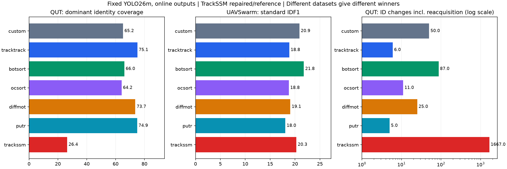

# Fixed-YOLO26m online MOT results

All six requested trackers were run with the existing detector. On the aircraft
clips, TrackTrack and PuTR preserve identity substantially better than the old
tracker. On the three small-drone sequences, BoT-SORT has the best aggregate
standard IDF1/HOTA among tested methods. There is no demonstrated universal winner
for small airborne targets viewed by a moving monocular camera.

**Practical shortlist:** TrackTrack + FastReID for aircraft identity continuity;
PuTR when specifically requiring learned association; BoT-SORT + FastReID as the
stronger fully labelled swarm baseline. Published DiffMOT and TrackSSM motion
checkpoints do not beat a simple linear predictor in our separate aircraft probe.
TrackSSM's substantial aircraft fragmentation makes this checkpoint unsuitable
for promotion here.

See [research and primary sources](MOT_RESEARCH.md), [side-by-side video gallery](demo/mot_comparison/index.html),
[machine-readable comparison](reports/mot_comparison.json), and [CSV](reports/mot_comparison.csv).

## Main measured comparison

QUT: six last-35-second clips, **5,250 frames and 7,309 approximate centre labels**
per tracker. ID changes include reacquisition after a detection gap; these are
centre-matching identity proxies, **not standard MOT IDSW/IDF1**. Dominant-ID
coverage is the fraction of labelled samples assigned to the most frequent
tracker ID for each target. Coverage and identity stability must be read together.

UAVSwarm: three complete sequences 02/06/28, **363 frames and 4,616 full box labels**,
official TrackEval Identity/CLEAR/HOTA implementations. Fixed detector, class
agnostic evaluation. This is a small predeclared diagnostic subset, not the full
public benchmark or a detector-training-independent test set.

FPS below counts actual **decode → unchanged YOLO26m inference → online tracking
→ drawing → H.264 NVENC export**, with one ordered export worker and at most two
pending frames. Model/import initialization and final JSON/hash generation are
outside this processing timer. This is offline throughput, not a streaming latency
guarantee or the full collision-analysis/Russian-dashboard pipeline.

| Method | QUT coverage | QUT ID changes incl. gaps ↓ | QUT dominant-ID coverage ↑ | Swarm IDF1 ↑ | Swarm standard IDSW ↓ | 720p FPS | Native 1080p FPS |
|---|---:|---:|---:|---:|---:|---:|---:|
| custom | 76.8% | 50 | 65.2% | 20.89 | 5 | — | — |
| tracktrack | 75.7% | 6 | 75.1% | 18.85 | 16 | 17.82 | 10.55 |
| botsort | 76.8% | 87 | 66.0% | 21.77 | 6 | 17.36 | 9.20 |
| ocsort | 74.7% | 11 | 64.2% | 18.77 | 10 | 33.63 | 14.22 |
| diffmot | 75.7% | 25 | 73.7% | 19.06 | 12 | 18.07 | 10.81 |
| putr | 75.5% | 5 | 74.9% | 18.05 | 4 | 19.90 | 10.50 |
| trackssm | 53.1% | 1667 | 26.4% | 20.28 | 23 | 15.43 | 9.94 |

All six requested methods meet 10 FPS at **1280×720** in these measurements. Native 1920×1080
eligibility is given by the measured last column; do not extrapolate to 4K or
larger target counts. TrackTrack/PuTR entries are medians of three fresh processes;
other async entries are single runs. “custom” is the existing control and has
no newly measured async-rendered timing.

720p: 300 consecutive processed frames from QUT M2, source 25 FPS, stride 1.
1080p: the entire 20.02-second real formation source, 29.970 FPS, stride 2,
**300 actual NN updates at a nominal 14.985 Hz sampling rate**. The measured FPS
counts processed updates, not all source frames. Each 1080p update includes the
full view and 16 native tiles; each 720p update includes the full view and six
native tiles. Detector weights, confidence 0.03, input tensor and suppression are
fixed. Appearance-enabled methods use the same published DanceTrack SBS-S50
checkpoint; PuTR uses its own published learned patch association model.

TrackSSM means **repaired decoder/tracker interface and eager reference Mamba
backend on Windows**. It is not a reproduction of the paper's optimized kernels.
Learned-motion and PuTR checkpoint keys load strictly; appearance inference keys
are checked. No random predictor is substituted.



## Runtime repetition and export checks

| Method | Input | Three-run FPS range | Median |
|---|---|---:|---:|
| tracktrack | M2 | 17.74–17.88 | 17.82 |
| tracktrack | formation | 10.53–10.58 | 10.55 |
| putr | M2 | 19.80–19.91 | 19.90 |
| putr | formation | 10.46–10.52 | 10.50 |

See [repeat measurements and exact trace checks](reports/mot_async_repeats.json),
[serial rendered timings](artifacts/mot/render_live), and
[detection/tracking-only timings](artifacts/mot/live).
Initialization is included separately in parent process timers. Machine/GPU/file
caches are uncontrolled; these are fresh Python processes on a warm machine.

The serial renderer can miss the 10 FPS native-1080p threshold even when inference
plus association passes it. Bounded export overlap is part of the qualifying
configuration, not a tracker-accuracy change. Full PTS/frame-count/codec verification
and serial-versus-async tracking equivalence are recorded in
[export QA](reports/mot_export_qa.json). Montage playback is recorded output and
does not represent inference speed.

## Detection coverage limits the drone benchmark

Raw fixed-detector IoU≥0.5 recall is **14.34% overall**: 0.03% on sw02, 61.18% on
sw06 and 22.45% on sw28. Median annotated target spans are 16, 27 and 19 pixels,
respectively. Consequently, a near-zero switch count on sw02 can simply mean that
almost nothing is tracked. BoT-SORT's standard IDF1 on sw06 is 68.5, much higher
than its aggregate across the detector-starved subset. Read
[per-sequence detector coverage](reports/mot_detector_coverage.json) and individual
`artifacts/mot/swarm/METHOD/mot_metrics.json` before interpreting aggregate rankings.

Removing SBS-S50 barely changes the two learned-motion systems on these three
sequences: DiffMOT IDF1 19.056 → 19.043; TrackSSM 20.280 → 20.315. These diagnostic
ablations do not establish useful aircraft identity information in the pedestrian
ReID embeddings. Predicted or smoothed boxes must remain separate from measured
YOLO box sizes if a tracker is integrated into the collision estimator.

## Separate next-frame motion probe

The same 1,080 five-observation historical YOLO samples are used for every
predictor. Approximate GT IDs select histories offline; models receive only past
box positions and box deltas. Next-frame label centres score the predictions.
No identity-oracle information enters online MOT runs. This is a pixel-space,
one-step diagnostic, not a future 3D flight trajectory or CPA measurement.

| Predictor | Samples | Median centre error, px ↓ | P90 error, px ↓ |
|---|---:|---:|---:|
| hold | 1080 | 1.876 | 5.125 |
| linear | 1080 | 1.918 | 4.798 |
| diffmot | 1080 | 3.390 | 6.677 |
| trackssm | 1080 | 25.429 | 48.265 |

The constant-position baseline is strong on these slow apparent trajectories.
The linear fit has the lower mean/P90 error than holding position. Neither
published learned-motion checkpoint improves this transfer test. The result
does not establish that a model trained on aircraft histories could not improve.

## Confidence-split sensitivity

A second check changes the tracker strong/new-track confidence to 0.18, the
project's earlier reference operating point, while keeping every YOLO detection
and the 0.03 detector floor unchanged. This enables the high/low association stages
in methods that support them. It uses two predeclared QUT clips (M2 and S2) plus
all three UAVSwarm sequences. It is a diagnostic sensitivity check, not exhaustive
tuning or an independent test. At 0.03, almost all retained detections are in the
strong tier; that configuration must not be confused with native paper settings.
OC-SORT's upstream weak-detection floor is 0.1, whereas the other tiered adapters
use 0.029. PuTR's second setting changes track initiation, not a Kalman matching
stage. These algorithm differences are retained and disclosed.

| Method | Tracker strong/new-track threshold | M2/S2 coverage | M2/S2 ID changes incl. gaps ↓ | M2/S2 dominant-ID coverage ↑ | Swarm IDF1 ↑ | Swarm IDSW ↓ |
|---|---:|---:|---:|---:|---:|---:|
| tracktrack | 0.03 | 80.6% | 2 | 79.2% | 18.85 | 16 |
| tracktrack | 0.18 | 74.7% | 1 | 74.6% | 17.46 | 15 |
| botsort | 0.03 | 81.4% | 30 | 65.2% | 21.77 | 6 |
| botsort | 0.18 | 68.4% | 32 | 56.6% | 20.82 | 2 |
| ocsort | 0.03 | 78.7% | 5 | 60.2% | 18.77 | 10 |
| ocsort | 0.18 | 65.7% | 1 | 65.4% | 15.49 | 10 |
| diffmot | 0.03 | 80.6% | 6 | 76.7% | 19.06 | 12 |
| diffmot | 0.18 | 67.8% | 4 | 60.5% | 17.50 | 12 |
| putr | 0.03 | 80.3% | 3 | 78.9% | 18.05 | 4 |
| putr | 0.18 | 77.9% | 0 | 77.9% | 17.73 | 3 |
| trackssm | 0.03 | 51.6% | 615 | 22.6% | 20.28 | 23 |
| trackssm | 0.18 | 41.7% | 402 | 22.7% | 16.64 | 20 |

These are different coverage/identity trade-offs. The hardware timings above
certify the 0.03 operating point; no rendered throughput is inferred from cached
replay for the alternative threshold. See [sensitivity data](reports/mot_confidence_sensitivity.json).

## Reproduction and provenance

Use the existing `.venv` directly; do not install an OpenCV wheel or run `uv sync`.
Additional dependencies are isolated in `external/mot/python_deps`. Repository
commits, local portability changes, all four checkpoint hashes/download origins,
and dependency versions are in [provenance](reports/mot_provenance.json). Downloaded
dataset files are verified against their pinned Git blob SHA and local SHA256 in
[dataset manifest](data/mot_swarm/manifest.json). No AOT or 3D simulator was used.

```powershell
.venv/Scripts/python.exe scripts/mot_benchmark.py --method putr --sequences M1,M2,M6,M7,S1,S2 --output artifacts/mot/reproduce_putr
.venv/Scripts/python.exe scripts/mot_benchmark.py --method tracktrack --sequences M2,formation --max-frames 300 --live --render --async-export --output artifacts/mot/reproduce_tracktrack_live
.venv/Scripts/python.exe scripts/mot_benchmark.py --method botsort --sequences sw02,sw06,sw28 --output artifacts/mot/reproduce_botsort_swarm
.venv/Scripts/python.exe scripts/mot_metrics.py artifacts/mot/reproduce_botsort_swarm
```

Run each tracker in a fresh process because the upstream research repositories
reuse Python package names. Scripts preserve causal online outputs: TrackTrack's
optional AFLink/interpolation and PuTR's retrospective submission rows are excluded.
Other protocol adaptations are listed explicitly in the research document.

The moving-camera formation footage has no identity ground truth. It validates
execution, throughput and visual behaviour; it cannot establish which model has
the lowest moving-camera identity-switch rate. A larger independently annotated
air-to-air MOT test set remains necessary for that claim. MASA-R50, coordinate-only
TWiX and 2026 HyperSSM are research candidates, not locally FPS-certified alternatives.
MOTIP/MOTIP2 require detector-feature adaptation rather than a ready-made frozen-YOLO
association plug-in.
