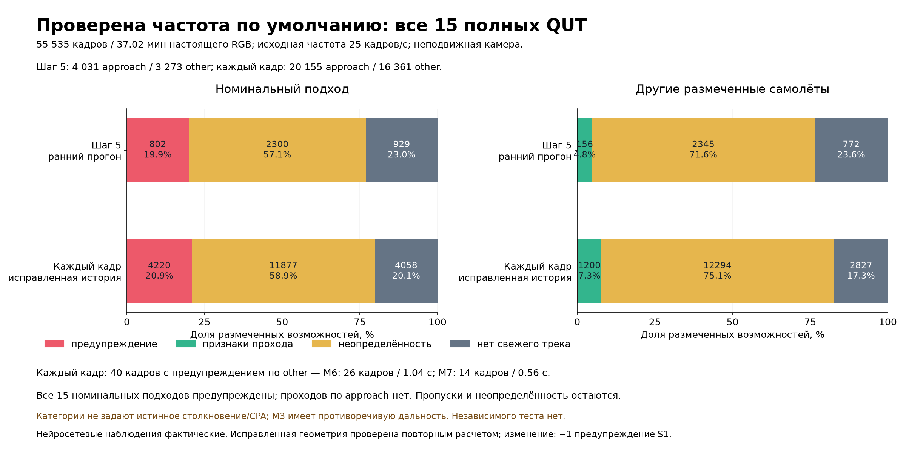
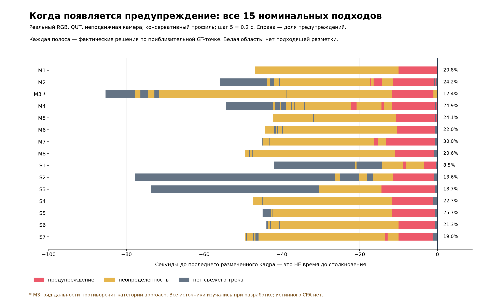

# Observed results

Start with [M2: different per-target decisions](demo/M2_final/annotated.mp4),
[M6: a category-warning failure](demo/M6_failure/annotated.mp4), and the
[Russian video gallery](demo/index.html). The runnable system uses real model
outputs to explain each target's state. It always abstains from recommending a
physical flight direction. This is an offline research prototype, with no novelty
or flight-readiness claim.

## Real RGB evidence

All 15 local QUT sources were processed: 55,531 actual TIFFs and 55,535 timeline
frames, including four explicitly recorded repeated missing frames. Duration is
2,221.4 seconds (37.02 minutes); dense TensorRT inference sampled 11,113 frames at
stride 5. The paper reports 55,521 frames; manifests retain the actual local
endpoints and missing IDs rather than silently changing them.

QUT shows an aircraft approaching a stationary grounded camera, with other aircraft
in some sequences. Published approach/other categories are **not physical collision
or CPA ground truth**. M3's range series conflicts with its approach category.
All sources had been inspected during development. These are extended development
results, with unknown detector-training overlap and no untouched test claim.

Approximate, often interpolated GT centroids are matched within 20 pixels. Each
denominator below is a labeled target-frame opportunity, including missed tracks.

| Configuration / cadence | Category | Warning | Conditional pass | Uncertain | No fresh track | Total |
|---|---|---:|---:|---:|---:|---:|
| GPU reference 0.18 / stride 5, all 15 | approach | 789 | 0 | 2073 | 1169 | 4031 |
| GPU reference 0.18 / stride 5, all 15 | other | 7 | 170 | 1840 | 1256 | 3273 |
| Conservative 0.03 / stride 5, all 15 | approach | 802 | 0 | 2300 | 929 | 4031 |
| Conservative 0.03 / stride 5, all 15 | other | 0 | 156 | 2345 | 772 | 3273 |
| Conservative 0.03 / every frame, all 15, corrected history | approach | 4220 | 0 | 11877 | 4058 | 20155 |
| Conservative 0.03 / every frame, all 15, corrected history | other | 40 | 1200 | 12294 | 2827 | 16361 |

At stride 5, all 15 nominal approach events have a warning episode of at least
2 seconds; 14 have at least 4 seconds. None of 13 known other-aircraft events warns.
The same-track growth-only baseline warns on 10/13 other events, with 476 warning
samples; it uses the same quality gates and confirmation durations.

**The zero-other-warning result does not generalize across processing cadence.**
Actual inference processed all 55,535 timeline frames of all 15 complete sources.
All 15 nominal approach events warn. Other aircraft receive 40 warning samples:
26 in M6 (96.16–97.16 seconds, 1.04 seconds of sample-hold support) and 14 in M7
(63.80–64.32 seconds, 0.56 seconds). Two of 13 other events have any warning;
only M6 reaches the report's 0.8-second event criterion. The shorter M7 pulse is
still a displayed warning and is retained in the results. The
[failure video](demo/M6_failure/annotated.mp4) and
[M7 source audit](reports/M7_fullrate_other_warning.png) show the actual cases.
These are category mismatches, not verified physical false-collision truth.

A final correctness audit found that history clearing still reinserted the last
clipped sample. The repaired implementation excludes it from later fits while
retaining raw positions for tracking/drawing. Replaying the actual full-rate
observations changes one S1 warning to uncertainty (4,221 → 4,220 approach-warning
samples); other category counts are unchanged. The table's final two rows use
that corrected geometry replay. No detector inference or GT was used inside the
repair. Fresh actual neural showcase runs verify the corrected implementation;
the recorded stride-5 rows remain the earlier measured phase. No matched approach
becomes a conditional pass in either cadence.



Warning onset is retrospective episode onset after later persistence is observed.
For all 15 stride-5 approaches, the first qualifying onset is 3.4–22.2 seconds
before the last labeled sample. The last label is **not impact or CPA time**.
M2 onset changes from 139.2 seconds at stride 5 to 119.4 seconds at stride 1.
See `reports/warning_timing.json` for support definitions, annotation-gap resets,
offline range context and per-event persistence. No true collision recall,
calibrated risk probability or false-alert rate per flight hour is established.



## Changes, ablations and failure analysis

The default conservative profile uses detector threshold 0.03, complete native
crop coverage, compatible CUDA preprocessing, a 2-pixel internal crop margin,
a 1-pixel source-boundary geometry guard, a 4-second fitting window and a 1-second
Bartlett covariance sensitivity bandwidth. Warning/pass confirmation is 0.24/1.2
seconds. Fitted uncertainty is heuristic; it is not a calibrated confidence interval.

On all 15 complete sources, lowering confidence from 0.18 to 0.03 under the same
geometry adds 237 tracked approach samples and 484 tracked other samples, mostly
uncertain. The gain persists at 5- and 10-pixel matching tolerances. Post-filtering
the 0.03 detections at 0.18 exactly reproduces separately executed 0.18 detections
and camera-validity flags on all 11,113 samples. Unmatched uncertain track samples
increase from 1,026 to 3,722; incomplete annotations do not make them all false detections.

The additional M1/M2/S2 confidence sweep at stride 2 tests 0.005/0.01/0.03/0.18.
Approach samples without a track are 110/124/198/320 of 1,314; unmatched uncertain
observations are 2,703/1,529/771/297. At 0.005, all 637 known other opportunities are
uncertain or untracked, with no conditional passes. Lower confidence improves
coverage but can disrupt association and does not monotonically improve warnings.
The default remains 0.03; the lower values lack full-source validation.

On the diagnosed full-rate M6 failure, inverse-span projective geometry increases
other warnings from 26 to 42. Bounded geometry removes them but reduces approach
warnings from 303 to 72, with many infeasible windows. A stricter residual cutoff
of 0.1 removes them and leaves 208 approach warnings. Across all 15 stride-5
sources, cutoffs 0.08/0.10/0.12/0.16 retain all 15 nominal warned events but yield
653/685/729/802 approach-warning samples. This is a post-failure abstention tradeoff,
not independent proof that another threshold is physically safer. Defaults were
not retuned on this single failure.

Optional adaptive crops and LoRAT appearance bridging were actually compared on
M1/M2/S2 short selections and complete M4, at matched stride 2. Dense/appearance/
independent-detector-span appearance give 555/569/559 approach-warning samples and
352/345/345 untracked samples out of 1,997. Other samples without tracks fall from
367 to 229 out of 1,872 with appearance bridging. These comparisons have no approach
passes or known other warnings. No-render throughput is 29.5–31.1 FPS for dense
and 41.1–46.9 FPS for the appearance variants; this is not annotated-video throughput.
A matched full-source extension on M6/S1/S3/S5 yields dense/mixed-size/independent-size
approach warnings 514/442/450 and untracked samples 924/990/990 out of 2,574.
Other warnings are 12/13/0 out of 495 opportunities (one M6 other event); all four
nominal approaches warn, with no approach passes. No-render rates are 29.69–31.41,
35.91–52.48 and 38.42–52.42 FPS respectively. Independent detector sizes remove
that M6 warning at this cadence, but the bridge loses approach coverage overall.
SOT confidence is uncalibrated; historical high-score drift remains a failure case.

The current S2 sky/zoom comparison reduces untracked approach opportunities from
178 to 49 out of 438, with warnings increasing from 136 to 147. Sky masking and
the whole-image proposal control have **identical detection and decision SHA-256
hashes**. Thus the extra RGB crops explain the measured gain here; no separate
sky-model contribution is demonstrated. The two-pass DINO workflow takes 48.43
seconds including preflight, hashes, both process startups and rendering: 9.04
processed FPS overall. Its assessment stage alone is 16.15 FPS. Mask-free zoom runs at 16.55 processing FPS (15.07 FPS including pipeline
preflight/model startup, excluding interpreter imports). It is optional and is not
a sky detector. DINO remains available for
other scenes; no independent segmentation accuracy is claimed.

Tiny objects remain missed, classes and box extents can be wrong, and partial
wings can become tracks. Contraction-only clearance is disabled: apparent shrinking
can reflect aspect, clipping or detector changes. Sky-conditioned pixel-silhouette
refinement performed worse and was rejected. Real native-resolution FPV and
helicopter videos remain entirely uncertain under the current camera scope.

## Geometry and observability

The offline full-rate GT-centroid/identity ablation supplies approximate annotation
positions and identities while retaining only independent actual detector span
samples. It produces 4,516 approach warnings / 15,639 uncertain out of 20,155,
and 31 other warnings / 1,291 passes / 15,039 uncertain out of 16,361. There is no
untracked state by construction because GT supplies object positions. Matched
current detector sizes exist on 15,519 approach and 12,492 other opportunities.
This is deliberately not camera-only performance or a physical upper bound;
interpolated approximate centroids can be optimistic. Substantial uncertainty
remains even with those oracle inputs (`reports/oracle_fullrate.json`).


Analytical tests isolate geometry from detection. Image-plane intercept can imply
clearance at wide bearings even when true CPA is small. The optional explicitly
calibrated estimator recovers CPA in assumed constant projected-span units in
ideal tests, but has no real calibrated-flight validation and never outputs metres.

Background stabilization also cannot identify rotation versus translation. A
constructed parallax case creates apparent passing motion during a true analytical
collision. Actual KLT/RANSAC on a controlled translated 2D texture gets 62/63 valid
background fits and 22 old-scope confirmed passes; the new scope abstains. These
are controlled projections/boxes, not real encounter or neural-detection evidence.
The default withholds pass states in camera auto mode even after a good background
fit. Warnings remain conditional. This is abstention, not recovered ego motion.

A separate existing synthetic AIR2LAND diagnostic processes 317 paired RGB/box
images from four predetermined variant IDs, with one missing image explicitly
listed. Full-frame/native-crop inference matches 310/312 supplied boxes at IoU ≥0.5
and emits 314/388 boxes. Heavy obscuration and poor visibility appear in failures;
GT boxes may include occluded content. Related landing scenarios are not independent
encounters. Source timing, calibration and pose units are unverified, so no temporal
threat or metric CPA scores are assigned and no simulator is operated. The primary
evidence remains real RGB. Metadata shows that span changes need not follow inverse
range; target orientation, occlusion and box convention remain fundamental limits.

## Measured rendered performance

Repeated M2 measurements before the final clipped-history exclusion, RTX 4060,
TensorRT batch 1, FP16-derived/mixed engine, source 1280×720,
stride 2, 438 processed frames, 1800×1140 Russian annotation, H.264 NVENC and one
separate render process:

| Sequential run | Processing FPS | Pipeline-preflight/startup-inclusive FPS |
|---|---:|---:|
| Current gallery M2 | 21.81 | 19.33 |
| Repeat 2 | 22.70 | 20.06 |
| Repeat 3 | 23.43 | 20.46 |

Processing includes decode, inference, tracking/camera/geometry, JSON traces,
render/export and flush. The second timer begins inside the pipeline; interpreter
and imports are outside it. Source time is preserved despite frame subsampling.
Native 1920×1080 FPV with 17 detector calls per sampled frame runs at 11.99 FPS
(10.79 FPS including pipeline preflight/startup). These are offline throughput
measurements, not streaming latency or universal real-time guarantees.

An earlier paired implementation measured serial/thread/process at 14.84/21.35/
24.09 FPS. Its 438 decoded output frames, neural detections, decisions and PTS match
exactly across those export modes (`reports/async_equivalence.json` and
`reports/process_equivalence.json`). Those values are historical paired evidence,
not substituted for the current three-run range. Workers allow two pending frames;
overlapping stage timings must not be added as if sequential.

## Reproduce and inspect

```powershell
.venv/Scripts/python.exe -m airavoid data/qut/M2.mp4 --camera fixed --stride 2 --encoder h264_nvenc --render-process --output demo/repeat
.venv/Scripts/python.exe -m airavoid C:/path/input.mp4 --camera auto --output demo/arbitrary
$env:AIRAVOID_TEST_NVENC='1'
.venv/Scripts/python.exe -m unittest discover -s tests -v
```

All 76 tests pass with actual NVENC enabled. All eight final videos decode fully
(3,000 frames); every presentation timestamp, frame count, duration and H.264/yuv420p
format is checked. Three sampled frames per video agree with corresponding source
frames and recorded-state overlays (maximum lossy-codec RMSE 4.06/255). This verifies
export consistency, not threat truth. Gallery playback was also checked in-browser.
Custom CUDA OpenCV version, path, full build fingerprint and device count match the
initial environment; an actual CUDA upload/download is exact. Verification is in
`reports/tests_latest.log`, `reports/video_qa.json` and `reports/environment_final.json`. Real-codec tests cover VFR/nonzero source timestamps,
process cleanup and failure status. Replay and diagnostic rendering never count
as live neural inference performance.

[README](README.md) protects the supplied CUDA OpenCV environment and lists external
weights. [GEOMETRY](GEOMETRY.md), [RESEARCH](RESEARCH.md) and [EXPERIMENTS](EXPERIMENTS.md)
separate assumptions, primary sources and measurements. The highest-value next step
is real calibrated RGB encounters with synchronized relative-motion ground truth
and an independently reserved evaluation set.

Fresh-process measurements additionally include Python interpreter/import startup.
Across three rendered runs per case, median end-to-end throughput is 19.88 FPS for
M2 (range 19.39–20.39), 14.43 FPS for mask-free S2 zoom (14.41–14.60), and 10.92 FPS
for native FPV (10.917–10.937). All nine detection and decision traces exactly match
their gallery references. These are sequential fresh processes on a warm machine;
OS, GPU and file caches are uncontrolled. See `reports/external_benchmark.json`.


After the final history repair, every canonical clip was regenerated with actual
neural inference (M6 remains an explicitly labeled recorded-observation excerpt).
Current single-run M2 is 23.81 processing FPS and 20.08 FPS from fresh process launch
to completed video. Native FPV is 12.26 / 10.66 FPS on those respective timers;
mask-free zoom is 16.55 / 14.62 FPS. These are actual final-run measurements, not a
replacement for the archived three-run variability study. That study's exact trace
references were preserved under `artifacts/pre_clip_history/`. Current M2 replay
through repaired logic exactly matches all 438 fresh neural decision rows.
