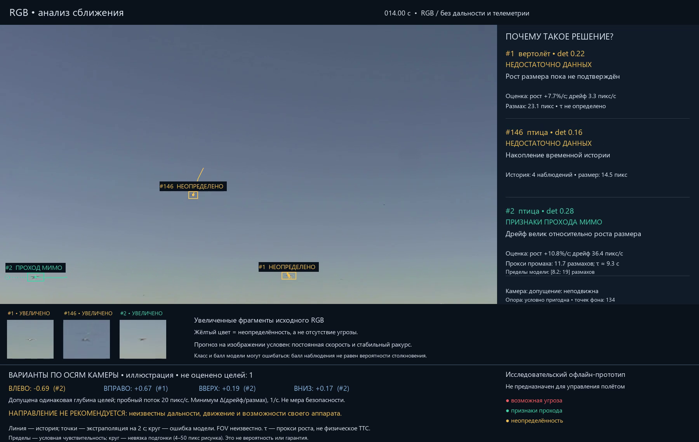

# Видеодемонстрация: решения, причины и ошибки

Откройте [галерею с видеоплеерами](index.html) или начните с
[M2: разные решения для разных целей](M2_final/annotated.mp4).
Все основные ролики получены на настоящем RGB. Панель «ПОЧЕМУ?» показывает
вычисленные показатели; разметка исследователей не поступает в алгоритм.

| Видео | Что смотреть | Что установлено |
|---|---|---|
| [M2, 35 с](M2_final/annotated.mp4) | На 14 с цель №2 зелёная, другие жёлтые; около 27 с растущая цель красная | Разные наблюдаемые признаки у одновременно видимых объектов. Классы YOLO могут быть ошибочны |
| [M1, 35 с](M1_final/annotated.mp4) | На 26 с предупреждение по приближающейся цели и неопределённость по другой | Слабая видимость и нестабильный размер ограничивают решение |
| [M6: ошибка, 12 с](M6_failure/annotated.mp4) | На 6.16–7.16 с отрывка, 96.16–97.16 с источника, красное предупреждение по категории other | 26 кадров / 1.04 с. Записанные решения полного покадрового прогона; для отрывка оценки не пересчитывались. Категория не задаёт истинный CPA |
| [S2: трудный случай, 35 с](S2_final/annotated.mp4) | На 10 с нет свежего трека, позже есть предупреждение | Пропуск самолёта не означает безопасность |
| [S2: дополнительные YOLO-фрагменты, 35 с](S2_zoom_final/annotated.mp4) | Сравните раннюю часть с обычным S2 | Дополнительный нейросетевой проход восстанавливает наблюдения; геометрия часто остаётся неопределённой |
| [FPV, 20 с](formation_final/annotated.mp4) | Настоящая воздушная съёмка 1920×1080, наклон горизонта и движение камеры | Все оценки неопределённы. Выравнивание фона не разделяет перенос и поворот камеры |
| [Беспилотный вертолёт, 14 с](helicopter_final/annotated.mp4) | Меняющийся ракурс и нестабильный размер | Все оценки неопределённы; меток столкновения нет |

Красный — **возможная угроза**, зелёный — **признаки прохода мимо по модели
изображения**, жёлтый — **недостаточно данных**. Это не вероятности и не гарантии.
Размах и дрейф измерены в пикселях; τ — прокси роста, а не физическое TTC.
Пунктир — условное продолжение движения на две секунды. Круг показывает остаток
подгонки с пределом 4–50 пикселей рисунка, а не опасный объём или калиброванную
доверительную область. Физический FOV неизвестен.

Внизу сравнивается изменение дрейфа для видимых целей при одном условном потоке
20 пикселей/с в изображении шириной 1280 пикселей. Допущены одинаковая глубина
целей и параллельный перенос; связь осей камеры с аппаратом неизвестна. Отрицательное
число означает ухудшение этого визуального критерия хотя бы для одной оценённой
цели. **Направление полёта не рекомендуется:** неизвестны дальности, динамика,
другие препятствия и возможности своего аппарата. Число неоценённых целей видно
в панели; их риск не считается нулевым.

[Полная диаграмма результатов](../reports/results_cadence_full.png) и
[временные полосы всех 15 подходов](../reports/warning_timeline.png) показывают
пропуски и неопределённость. В основном прогоне с шагом 5 предупреждение есть во
всех 15 номинальных подходах и отсутствует в 13 событиях other. Но проверка каждого
кадра всех 15 полных источников выявила 40 кадров с предупреждением по категории other:
26 кадров / 1.04 с в M6 и 14 кадров / 0.56 с в M7. Предупреждение есть в двух из
13 событий other; только M6 достигает критерия 0.8 с. Нельзя переносить нулевой результат между частотами обработки.

QUT снят неподвижной наземной камерой; это не подтверждённое столкновение двух
воздушных аппаратов. M3 имеет противоречивую разметку дальности. Все эти источники
уже изучались при разработке, а происхождение обучения детектора неизвестно.
Проверки FPV и вертолёта качественные, без истинной геометрии столкновения.
Все пять классов поддерживаются одинаковыми правилами угрозы; независимой проверки
угроз для птицы, аэростата и парашюта нет. Неверная метка «птица» на самолёте такой
проверкой не является.

[Опциональный DINO-ролик S2](S2_sky_current/assessment/annotated.mp4) сохранён как
эксперимент: 178 → 49 кадров без свежего трека из 438. Контроль без выбора sky-области
дал идентичные наблюдения и решения; отдельный вклад sky-модели не доказан.
Оба прохода DINO-варианта со всеми запусками заняли 48.43 с, или 9.04 обработанного
кадра/с. Текущий M2 даёт 20.08 кадра/с с запуском Python (23.81 кадра/с без начального запуска) на RTX 4060.
Это офлайн-производительность, не гарантия потоковой задержки.

Старые ролики сохранены для аудита. Краткое красное/зелёное совпадение в
[M2_confirmed](M2_confirmed/annotated.mp4) включало обрезанную цель и не служит
доказательством надёжной оценки. Старое правило «уменьшение размера — проход»
отключено после ошибок M4. Новые варианты переводят такие наблюдения в
неопределённость. Это исправления на изученных данных.

[Подробные результаты и ограничения на английском](../RESULTS.md),
[запуск и воспроизведение](../README.md). Прототип не предназначен для управления полётом.
